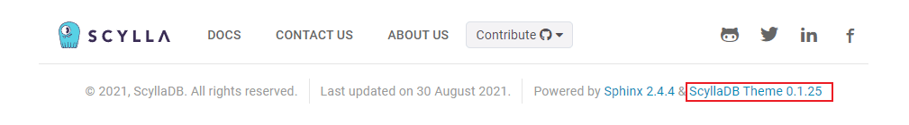

Upgrading from 1.9 to 1.10
==========================

This guide explains how to upgrade the version of the ScyllaDB Sphinx Theme
from 1.9 to 1.10.

How to check your current theme version
---------------------------------------

The theme version is displayed in the footer of the project's documentation site.

If your project theme's version is **>=1.9**, follow this guide to get the
latest version.

What's new in 1.10
------------------

See the :doc:`CHANGELOG <CHANGELOG>` for the full list of changes in this
release.

Upgrade to version 1.10
-----------------------

Enable the redirect validator on pull requests
..............................................

1. Add a ``check-redirects`` **target to** ``docs/Makefile``.
    It checks every ``/stable/`` redirect target is reachable on the live site:

.. code-block:: makefile

    .PHONY: check-redirects
    check-redirects: setup
        $(UV) run scylla-check-redirects --yaml _utils/redirects.yaml --conf $(SOURCEDIR)

2. Add a step to** ``.github/workflows/docs-pr.yaml`` before the docs build so bad redirects fail fast:

.. code-block:: yaml

    - name: Check redirects
      run: make -C docs check-redirects

Update GitHub Actions workflows
...............................

Version 1.10 adds documentation build reports to pull requests. Failed builds
show warnings and errors in a **Docs / Build PR** comment, the Actions summary,
and the build log. When the build passes, the comment is removed.

#. Replace ``.github/workflows/docs-pr.yaml`` with the updated
   `docs-pr.yaml <https://github.com/scylladb/sphinx-scylladb-theme/blob/1.10.0/.github/workflows/docs-pr.yaml>`_.
#. Copy `docs-pr-report.yaml <https://github.com/scylladb/sphinx-scylladb-theme/blob/1.10.0/.github/workflows/docs-pr-report.yaml>`_
   into your repository's ``.github/workflows/`` directory.
#. Adjust the default branch and documentation paths if needed. If you use a
   different workflow name, update ``workflow_run.workflows`` in
   ``docs-pr-report.yaml`` to match it.
#. Commit and push both workflows to your project's default branch.

Both workflows use the shared ``docs-report`` action. You only need to
copy the workflow files. The reporting workflow runs separately so builds
from forks keep read-only permissions.

These workflows are available with the ``1.10.0`` release. Updating the theme
package alone does not update your project's workflows.

For details, see :ref:`docs-build-reports`.